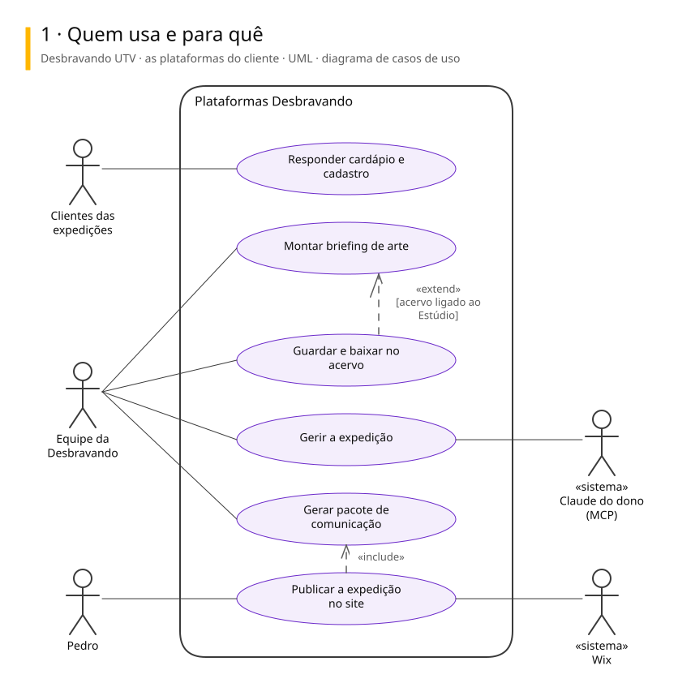
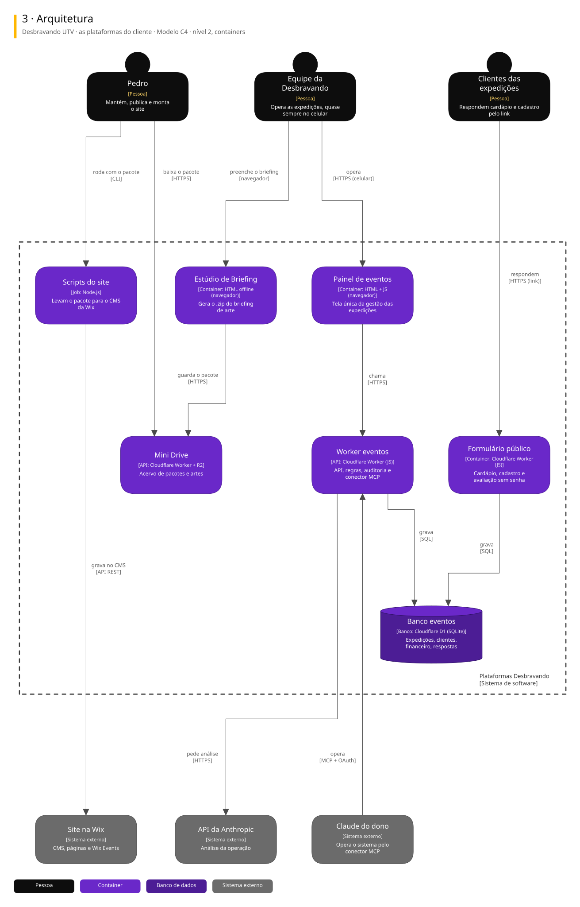
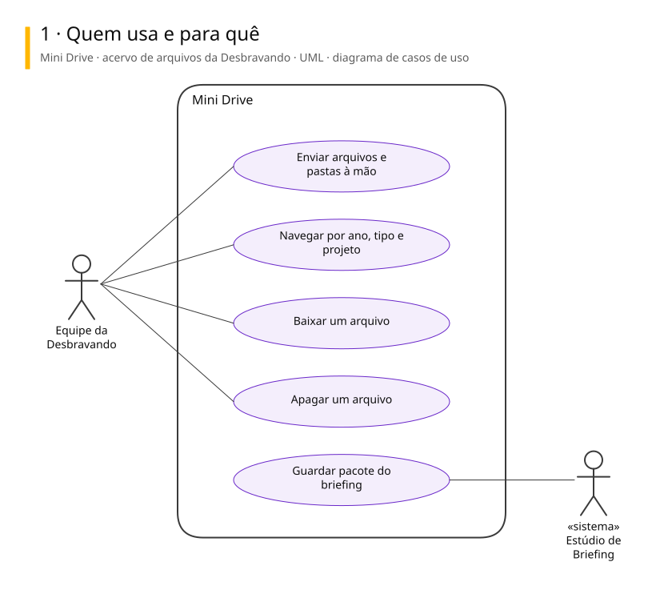
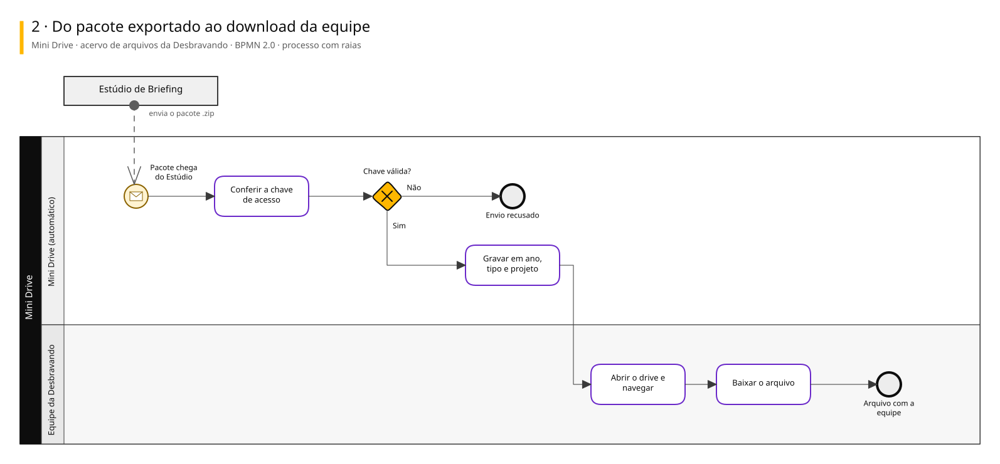
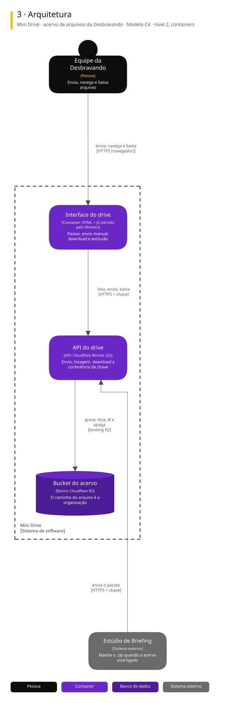

# Arquitetura

Diagramas de 2 sistemas ligados a este repositório. Cada um tem três vistas, cada vista numa notação padrão.

| Vista | Notação | Responde |
|---|---|---|
| 1. Casos de uso | UML | Quem usa e para quê |
| 2. Processo | BPMN 2.0 | Como o trabalho anda, com uma raia para cada quem executa |
| 3. Arquitetura | C4, nível 2 | De que partes o sistema é feito e com quem conversa |

## Desbravando UTV · as plataformas do cliente

Guarda-chuva das ferramentas que o Pedro mantém para a Desbravando UTV, operação de expedições de UTV: controle das expedições, formulário público, acervo de arquivos, estúdio de briefing e o site na Wix.

### 1. Quem usa e para quê

### 2. Da expedição fechada à página no site

### 3. Arquitetura

Para editar: [desbravando-utv.excalidraw](./desbravando-utv.excalidraw), que abre em [excalidraw.com](https://excalidraw.com) ou na extensão Excalidraw do VS Code.

## Mini Drive · acervo de arquivos da Desbravando

Acervo online da Desbravando UTV num Worker com R2: guarda pacotes de briefing, artes e entregáveis por ano, tipo e projeto, para a equipe baixar sem depender da máquina de ninguém.

### 1. Quem usa e para quê

### 2. Do pacote exportado ao download da equipe

### 3. Arquitetura

Para editar: [mini-drive.excalidraw](./mini-drive.excalidraw), que abre em [excalidraw.com](https://excalidraw.com) ou na extensão Excalidraw do VS Code.

## De onde vêm

Os diagramas são gerados a partir do Sinapse, o vault onde o Pedro organiza notas e projetos. Mudança feita direto aqui some na próxima publicação: o lugar de mudar é a especificação no Sinapse.
