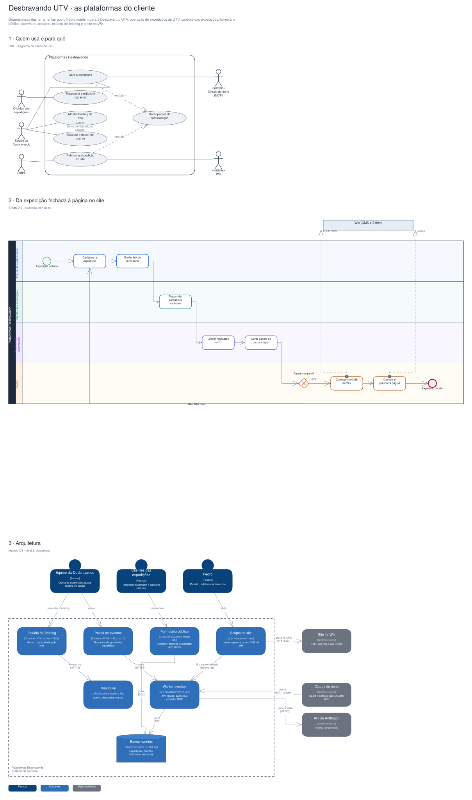
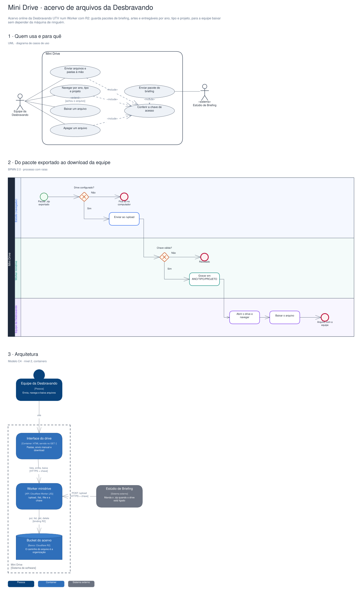

# Arquitetura

Diagramas gerados a partir do Sinapse (o segundo cérebro do Pedro). Cada projeto tem três vistas,
cada uma numa notação padrão:

1. **Quem usa e para quê**: UML, diagrama de casos de uso.
2. **O processo principal**: BPMN 2.0, com raias por quem executa.
3. **A arquitetura**: modelo C4, nível 2 (containers).

## Desbravando UTV · as plataformas do cliente

Guarda-chuva das ferramentas que o Pedro mantém para a Desbravando UTV, operação de expedições de UTV: controle das expedições, formulário público, acervo de arquivos, estúdio de briefing e o site na Wix.

Editável: [`desbravando.excalidraw`](./desbravando.excalidraw), abre em [excalidraw.com](https://excalidraw.com) ou no VS Code com a extensão Excalidraw.

## Mini Drive · acervo de arquivos da Desbravando

Acervo online da Desbravando UTV num Worker com R2: guarda pacotes de briefing, artes e entregáveis por ano, tipo e projeto, para a equipe baixar sem depender da máquina de ninguém.

Editável: [`mini-drive-desbravando.excalidraw`](./mini-drive-desbravando.excalidraw), abre em [excalidraw.com](https://excalidraw.com) ou no VS Code com a extensão Excalidraw.

A fonte destes arquivos é o vault do Sinapse (`09-DESENHOS/`); alterações feitas aqui são sobrescritas na próxima publicação.
